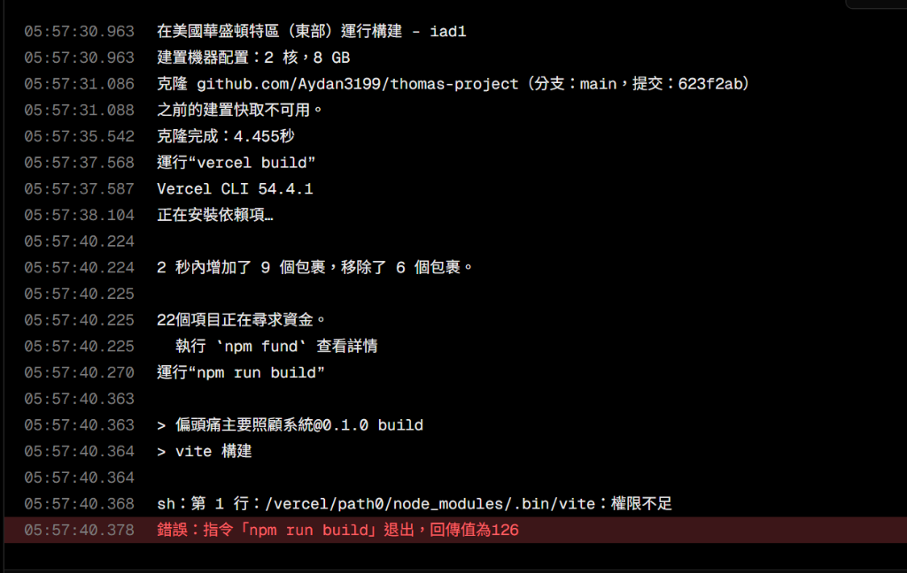
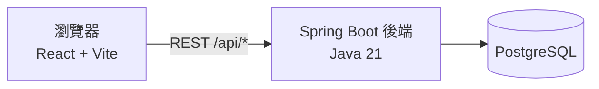

# 偏頭痛個案照護管理系統

一套結合**病患、醫師、個案管理師**三種角色的偏頭痛照護 Web 系統：病患記錄頭痛日記與填寫量表，醫師查看病患資料並開立處方，個管師追蹤個案狀態。

> 學術專案　|　組員：許學瀅、馮宣諺、李弘禹　|　指導老師：黃建中老師



更多展示資料見 [`docs/`](docs/)：學術海報 [`poster.html`](docs/poster.html)、簡報 [`Thomas_Project_Pitch_Deck.pptx`](docs/Thomas_Project_Pitch_Deck.pptx)、程式碼彙整 [`Thomas_Codebase.pdf`](docs/Thomas_Codebase.pdf)。

---

## 功能

| 角色 | 路由 | 主要功能 |
| :--- | :--- | :--- |
| 病患 | `/patient` | 頭痛日記、填寫問卷、個人統計圖表 |
| 醫師 | `/doctor` | 檢視病患紀錄、開立處方 |
| 個案管理師 | `/caseManager` | 檢視個案清單、更新追蹤狀態 |

- 依角色做路由保護，登入後自動導向對應頁面（見 [`src/App.tsx`](src/App.tsx)）。
- 內建 8 種量表：MIDAS、BDI、HADS、PSQI、PSS、FSS、WPI、Allodynia（見 [`src/components/questionnaires/`](src/components/questionnaires/)）。
- 問卷分數與日記資料會同步呈現於醫師與個管師端。

## 技術架構



**前端**：React 18、TypeScript、Vite 6、Tailwind CSS 4、Radix UI、React Router 7、Zustand、Recharts

**後端**：Spring Boot 4.0.5、Java 21、Spring Data JPA、PostgreSQL、Gradle、Lombok

**部署**：前端為 Vercel（見 [`src/vercel.json`](src/vercel.json)），後端附 [`Dockerfile`](thomas-backend/Dockerfile)（註解標示用於 Render）

## 專案結構

```text
.
├── src/                    # 前端原始碼
│   ├── components/         #   頁面與元件（含 questionnaires/、ui/）
│   ├── store/              #   Zustand 狀態（登入狀態）
│   └── config.ts           #   API 位址設定
├── thomas-backend/         # Spring Boot 後端
│   └── src/main/java/com/thomas/backend/
│       ├── controller/     #   REST API
│       ├── model/          #   JPA 實體
│       └── repository/     #   資料存取
├── docs/                   # 海報、簡報、截圖、程式碼彙整
├── scripts/                # 輔助腳本
├── index.html              # Vite 入口
├── package.json
└── vite.config.ts
```

## 快速開始

### 需求

- Node.js 18 以上
- JDK 21、PostgreSQL（僅啟動後端時需要）

### 1. 前端

```bash
npm ci
npm run dev        # 開發伺服器
npm run build      # 建置至 dist/
```

前端預設連線到 `http://<目前網址的主機名稱>:8080`。要指定後端位址，請設定環境變數：

```bash
# .env.local
VITE_API_URL=https://your-backend.example.com
```

### 2. 後端

```bash
cd thomas-backend
./gradlew bootRun          # Windows：gradlew.bat bootRun
```

預設連線 `jdbc:postgresql://localhost:5432/thomas_db`，可用環境變數覆寫：

| 變數 | 預設值 |
| :--- | :--- |
| `SPRING_DATASOURCE_URL` | `jdbc:postgresql://localhost:5432/thomas_db` |
| `SPRING_DATASOURCE_USERNAME` | `postgres` |
| `SPRING_DATASOURCE_PASSWORD` | `postgres` |

服務埠號為 `8080`。使用 Docker：

```bash
cd thomas-backend
docker build -t thomas-backend .
docker run -p 8080:8080 \
  -e SPRING_DATASOURCE_URL=... -e SPRING_DATASOURCE_USERNAME=... -e SPRING_DATASOURCE_PASSWORD=... \
  thomas-backend
```

## API 一覽

| 路徑 | 方法 | 說明 |
| :--- | :--- | :--- |
| `/api/auth/register` | POST | 註冊 |
| `/api/auth/login` | POST | 登入 |
| `/api/auth/init` | GET | 資料庫為空時建立示範帳號 |
| `/api/users/patients` | GET | 病患清單 |
| `/api/users/{id}` | PUT | 更新使用者資料 |
| `/api/diaries/user/{userId}` | GET | 取得某使用者的頭痛日記 |
| `/api/diaries` | POST | 新增日記 |
| `/api/diaries/{id}` | DELETE | 刪除日記 |
| `/api/questionnaires/patient/{patientId}` | GET | 取得某病患的問卷結果 |
| `/api/questionnaires` | POST | 送出問卷 |
| `/api/prescriptions/patient/{patientId}` | GET | 取得某病患的處方 |
| `/api/prescriptions` | POST | 開立處方 |
| `/api/casemanager/patients` | GET | 個管師的個案清單 |
| `/api/casemanager/tracking/{patientId}` | PUT | 更新追蹤狀態 |

## 已知限制

這是學術專案，以下項目在用於真實資料前**必須處理**：

- **密碼以明文儲存並比對**（[`AuthController.java`](thomas-backend/src/main/java/com/thomas/backend/controller/AuthController.java)），應改用 BCrypt 等雜湊，並加入 Spring Security。
- **後端未引入 Spring Security**（見 [`build.gradle`](thomas-backend/build.gradle)），API 端點沒有框架層級的存取控管；角色檢查目前只在前端路由（`ProtectedRoute`）。
- **`/api/auth/init` 公開可呼叫**，會在資料庫為空時建立弱密碼的示範帳號，正式環境應移除。
- `spring.jpa.hibernate.ddl-auto=update` 與 `show-sql=true` 適合開發，不建議用於正式環境。
- `src/` 內有 `package.json`、`vite.config.ts`、`vercel.json` 等檔案，與根目錄版本不一致，疑為匯出時的殘留，尚待確認後清理。
- `src/supabase/` 與 `src/utils/supabase/` 為設計工具匯出的殘留，前端程式碼目前並未使用 Supabase。

## 設計稿

UI 設計稿來自 [Figma](https://www.figma.com/design/jB30xBkbeEfrpoEcuKqJhd/%E5%81%8F%E9%A0%AD%E7%97%9B%E5%80%8B%E6%A1%88%E7%85%A7%E8%AD%B7%E7%B3%BB%E7%B5%B1)。